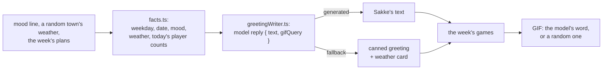

# Morning greeting

Every morning at 09:00 Helsinki time (`policy.ts`, independent of the container's time zone) to
`MORNING_CHAT_ID`; nothing when it is unset. Each part is sent even if another fails:

1. **Sakke's greeting**, written by the bot's model (`greetingWriter.ts`) from the day's facts, as
   plain text. When the model is off (`LLM_ENABLED`), fails, or replies with something unusable, the
   canned greeting goes out instead: a random opening line with the time (HTML), then the weather card
   from `../weather-report/`.
2. **The coming week's games** of `GAMES_CHAT_ID`, the planning group: "Tänään pelataan" and
   "Tulossa" with the plan numbers for `/mukaan`, then an invitation to join in SakariPelit. Left out
   when `GAMES_CHAT_ID` is unset or nothing is planned. This is the one place a plan is read outside
   the chat it was made in.
3. **A GIF**, sent as an animation, found on Giphy with the word the model picked, or a random one.

## The model's part

- **Facts only** (`facts.ts`): the weekday and date, one of the canned lines as the day's mood
  (`phrases.ts`), the weather, and today's games as player counts. Course names and times are left
  out: the games list follows with them exactly, and the model garbled them.
- **The prompt** is `src/prompts/persona.md` plus `src/prompts/morning_greeting.md`: the group's
  running jokes (Jallu, hangovers, Tali or work), the rules, and example greetings.
- **The reply** (`schema.ts`) is JSON constrained by Ollama to `{ text, gifQuery }`, where
  `gifQuery` is one of `giphySearchWords`. Stray quote marks around the text are removed.

## Entry points

| Entry point | Called by |
| --- | --- |
| `startMorningGreeter` | `main.ts` at startup |
| `sendMorningGreeting` | `/aamuu` (`telegram/commands/dev/`), on demand |

## Data

None.

## Files

| File | Does |
| --- | --- |
| `morningGreeting.ts` | The daily timer and the greeting's parts, in order. |
| `policy.ts` | When the next greeting is: 09:00 in Helsinki, with that day's DST. |
| `facts.ts` | The facts the model writes from. |
| `prompts.ts` | The system prompt (persona and greeting prompt) and the request with the facts. |
| `greetingWriter.ts` | Asks the model; returns its greeting, or why the canned one is used. Never throws. |
| `schema.ts` | The model's reply: its example, the Zod schema and the JSON schema Ollama constrains to. |
| `gamesPart.ts` | The games part's text, from the plans and today's date. |
| `messages.ts` | The canned greeting text and the games invitation. |
| `phrases.ts` | The canned opening lines (also the model's mood lines) and the GIF search words. |
