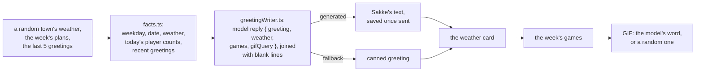

# Morning greeting

Every morning at 09:00 Helsinki time (`policy.ts`, independent of the container's time zone) to
`MORNING_CHAT_ID`; nothing when it is unset. Each part is sent even if another fails:

1. **Sakke's greeting**, written by the bot's model (`greetingWriter.ts`) from the day's facts, as
   plain text in three paragraphs with a blank line between: a greeting to the club, one joke about
   the weather (left out when there's no weather), and a comment on today's games, or a jab at the
   lazy ones when there are none. When the model is off (`LLM_ENABLED`), fails, or replies with
   something unusable, the canned greeting goes out instead: a random opening line with the time
   (HTML). Sakke's own greeting is saved once it's sent, so the next ones can differ from it; the
   canned one isn't.
2. **The weather card** of the random town (`../weather-report/`), with its emojis; left out when the
   weather can't be read.
3. **The coming week's games** of `GAMES_CHAT_ID`, the planning group: "Tänään pelataan" and
   "Tulossa" with the plan numbers for `/mukaan`, then an invitation to join in SakariPelit. Left out
   when `GAMES_CHAT_ID` is unset or nothing is planned. This is the one place a plan is read outside
   the chat it was made in.
4. **A GIF**, sent as an animation, found on Giphy with the word the model picked, or a random one.

## The model's part

- **Facts only** (`facts.ts`): the weekday and date, the weather, and today's games as player
  counts. No canned line: the model copied it word for word. Course names and times are left
  out: the games list follows with them exactly, and the model garbled them. The weather is material
  for a joke; the card that follows gives its numbers.
- **Recent greetings:** each greeting is a separate model call, so the model can only vary from day
  to day by seeing what it wrote before. It gets the chat's last 5 greetings (newest first) and is
  told to open differently and not reuse their jokes or phrases. Without them, q4 opened 8 times
  in 12 with the same "Huomenta porukka". If they can't be read, the greeting goes without.
- **The prompt** is `src/prompts/persona.md` plus `src/prompts/morning_greeting.md`: the group's
  running jokes (Jallu, hangovers, Tali or work), each part's own rules, and example greetings in
  parts. Like the commentary, the model writes the parts and the code puts the message together,
  so the blank lines don't depend on the model.
- **The reply** (`schema.ts`) is JSON constrained by Ollama to `{ greeting, weather, games, gifQuery }`,
  where `gifQuery` is one of `giphySearchWords`. Stray quote marks around each part are removed;
  an empty greeting or games part makes the reply unusable, and the weather part is dropped when
  there was no weather.
- **Tuning the prompt:** `npm run eval:greeting` writes greetings for scenario days against a
  real model and checks them; see "Morning greeting eval harness" in the root README.

## Entry points

| Entry point | Called by |
| --- | --- |
| `startMorningGreeter` | `main.ts` at startup |
| `sendMorningGreeting` | `/aamuu` (`telegram/commands/dev/`), on demand |

## Data

`morning_greetings` (`db/`): Sakke's sent greetings per chat, with the time; kept, never deleted.
Saved as a background write with `withWriteRetry`; a failed save is logged and only costs the next
greeting some variety. A stopgap: the long-term home for Sakke's own writing is the Obsidian vault,
through gateway tools (Trello LXyiAGHC).

## Files

| File | Does |
| --- | --- |
| `morningGreeting.ts` | The daily timer and the greeting's parts, in order. |
| `policy.ts` | When the next greeting is: 09:00 in Helsinki, with that day's DST. |
| `facts.ts` | The facts the model writes from. |
| `prompts.ts` | The system prompt (persona and greeting prompt, or a variant from the eval) and the request with the facts. |
| `greetingWriter.ts` | Asks the model; returns its greeting, or why the canned one is used. Never throws. |
| `schema.ts` | The model's reply: its example, the Zod schema and the JSON schema Ollama constrains to. |
| `gamesPart.ts` | The games part's text, from the plans and today's date. |
| `messages.ts` | The canned greeting text and the games invitation. |
| `phrases.ts` | The canned opening lines and the GIF search words. |
| `db/` | The `morning_greetings` entity and its repository: save a greeting, read a chat's last ones. |
